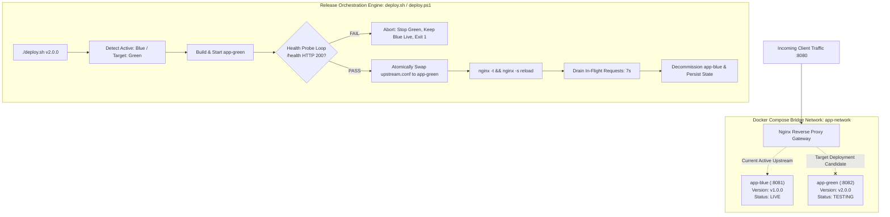

# Zero-Downtime Application Release Engineering Using Docker Compose and Automated Nginx Blue-Green Deployment

A production-ready DevOps implementation demonstrating zero-downtime releases using Docker Compose, dynamic Nginx reverse proxy routing, automated health probes, graceful connection draining, and instant automated rollbacks.

---

## 1. System Architecture



### Architectural Highlights
- **Active / Idle Environments**: Two identical application containers running in parallel (`app-blue` on port 8081, `app-green` on port 8082) connected via a dedicated bridge network (`app-network`).
- **Nginx Reverse Proxy Gateway**: Exposed publicly on port `8080`, routing traffic to the active upstream defined in `nginx/conf.d/upstream.conf`.
- **Pre-Activation Health Probes**: Before routing any live traffic to the newly deployed container, the orchestration engine polls its internal `/health` endpoint up to 15 times.
- **Hot Configuration Reload**: Nginx master process executes a configuration syntax test (`nginx -t`) and issues a graceful worker reload (`nginx -s reload`), maintaining active TCP sockets without terminating existing connections.
- **Graceful Connection Draining**: A configurable 7-second draining period guarantees in-flight requests on the retiring environment complete before the old container is stopped.
- **Zero Dropped Packets**: Concurrently validated by a high-frequency load script dispatching 10 requests/second with 0 dropped packets (HTTP 502/503).
- **Automated Rollback**: If the new container fails health checks, the script aborts immediately, stops the unhealthy candidate, preserves the live environment, and exits with code 1.

---

## 2. Project Directory Structure

```text
nginx-blue-green-deployment/
├── .active_env               # State file tracking current active environment (blue/green)
├── docker-compose.yml        # Multi-container orchestration (app-blue, app-green, nginx)
├── deploy.sh                 # Production Bash deployment automation script
├── deploy.ps1                # Native Windows PowerShell deployment automation script
├── test-traffic.sh           # High-frequency Bash traffic monitor (10 req/s)
├── test-traffic.ps1          # Native Windows PowerShell traffic monitor
├── README.md                 # Complete documentation and operational manual
├── app/
│   ├── Dockerfile            # Multi-stage, non-root Alpine container build
│   ├── .dockerignore         # Docker build context exclusions
│   ├── package.json          # Application dependencies (Express.js)
│   └── server.js             # Web service with visual dashboard, /health probe, & chaos hooks
└── nginx/
    ├── nginx.conf            # Base Nginx configuration (buffers, timeouts, keepalive)
    └── conf.d/
        ├── default.conf      # Reverse proxy server block & proxy header forwarding
        └── upstream.conf     # Dynamic upstream pool target (swapped at runtime)
```

---

## 3. Prerequisites

- **Docker Engine** (20.10+) & **Docker Compose v2** (`docker compose version`)
- **cURL** or **Windows PowerShell** 5.1+ / PowerShell 7+
- **Bash** (Linux, macOS, WSL, or Git Bash) OR **PowerShell** for native Windows execution

---

## 4. Quickstart Guide

### Step 1: Initial System Bootstrap (Deploy Initial Blue Environment)

Navigate into the project directory:

```bash
cd nginx-blue-green-deployment
```

Start the initial `app-blue` container and `nginx` proxy:

```bash
# Set initial version tag
export APP_VERSION=v1.0.0

# Start blue app and nginx
docker compose up -d --build app-blue nginx
```

*(On Windows PowerShell:)*
```powershell
$env:APP_VERSION = "v1.0.0"
docker compose up -d --build app-blue nginx
```

### Step 2: Verify Initial Service Health

Check that Nginx is proxying to the live `blue` environment:

```bash
curl -s http://localhost:8080/health
```

**Expected JSON Response:**
```json
{
  "status": "UP",
  "version": "v1.0.0",
  "env": "blue",
  "hostname": "app-blue",
  "uptimeSeconds": 10,
  "timestamp": "2026-09-22T05:00:00.000Z"
}
```

You can also open **`http://localhost:8080/`** in any web browser to view the visual Blue Environment Dashboard.

---

## 5. Live Demonstration: Zero-Downtime Release (v1.0.0 -> v2.0.0)

To verify that releases occur with **zero downtime and zero dropped packets**, run the traffic monitor concurrently during deployment.

### Terminal 1: Launch Continuous Traffic Load Monitor

In your first terminal, start the traffic generator:

```bash
# Linux / macOS / Git Bash
./test-traffic.sh
```

*(Or on Windows PowerShell:)*
```powershell
.\test-traffic.ps1
```

The script will continuously dispatch 10 HTTP requests/second to `http://localhost:8080/`:
```text
[2026-09-22 10:30:00] HTTP 200 | Env: BLUE  | Ver: v1.0.0 | Latency: 0.004s
[2026-09-22 10:30:01] HTTP 200 | Env: BLUE  | Ver: v1.0.0 | Latency: 0.003s
...
```

### Terminal 2: Trigger Automated Blue-Green Release to `v2.0.0`

In your second terminal, run the deployment automation script:

```bash
# Linux / macOS / Git Bash
chmod +x deploy.sh test-traffic.sh
./deploy.sh v2.0.0
```

*(Or on Windows PowerShell:)*
```powershell
.\deploy.ps1 -Version "v2.0.0"
```

### What Happens Behind the Scenes:
1. **Detection**: The script reads `.active_env`, determines that `BLUE` is live, and selects `GREEN` (port 8082) as the target.
2. **Build & Spin Up**: Builds the new Docker image tagged `v2.0.0` and starts `app-green`.
3. **Health Validation**: Polls `http://127.0.0.1:8082/health` until HTTP 200 OK is received.
4. **Atomic Switch**: Updates `nginx/conf.d/upstream.conf` to point to `app-green:8082`.
5. **Hot Reload**: Executes `docker compose exec nginx nginx -s reload` without stopping Nginx or closing active client sockets.
6. **Connection Draining**: Pauses for 7 seconds to let remaining in-flight requests to `app-blue` conclude.
7. **Decommissioning**: Stops `app-blue`.

### Observed Zero-Downtime Switch in Terminal 1:

Terminal 1 will automatically capture the seamless transition:
```text
[2026-09-22 10:30:15] HTTP 200 | Env: BLUE  | Ver: v1.0.0 | Latency: 0.003s
[2026-09-22 10:30:16] HTTP 200 | Env: BLUE  | Ver: v1.0.0 | Latency: 0.004s

>>> [SWAP DETECTED] Transitioned from blue:v1.0.0 to green:v2.0.0 (0 Dropped Packets) <<<

[2026-09-22 10:30:16] HTTP 200 | Env: GREEN | Ver: v2.0.0 | Latency: 0.004s
[2026-09-22 10:30:17] HTTP 200 | Env: GREEN | Ver: v2.0.0 | Latency: 0.003s
```

Press `Ctrl + C` in Terminal 1 to view the report:
```text
=================================================================
                 TRAFFIC MONITOR REPORT
=================================================================
Total Monitoring Duration:   45s
Total Requests Dispatched:   450
Successful Responses (200):  450
Dropped / Error Responses:   0
Packet Delivery Rate:        100.00%

>>> ZERO DOWNTIME VERIFIED: 0 DROPPED PACKETS DURING DEPLOYMENT <<<
=================================================================
```

---

## 6. Failure Simulation & Automated Rollback Demonstration

A release automation pipeline must protect production against broken code. This project includes built-in failure simulation to test automatic rollbacks.

### Trigger Deployment with Broken Health Check

Run the deployment script with the `--simulate-failure` flag:

```bash
# Linux / macOS / Git Bash
./deploy.sh --simulate-failure v2.1.0-broken
```

*(Or on Windows PowerShell:)*
```powershell
.\deploy.ps1 -Version "v2.1.0-broken" -SimulateFailure
```

### Execution Output & Rollback Behavior:
```text
===> Step 1: Detecting Currently Active Environment
Currently Active Environment: GREEN
Target Deployment Candidate:  BLUE
Target Port:                  8081
Release Version:              v2.1.0-broken
Simulation Mode:              SIMULATE_FAILURE ENABLED (Test Rollback)

===> Step 2: Building & Provisioning Target Container [app-blue]
...
===> Step 3: Performing Automated Health Probes on [app-blue:http://localhost:8081/health]
[WARN] Attempt 1/15: Received HTTP 500. Waiting 2s...
[WARN] Attempt 2/15: Received HTTP 500. Waiting 2s...
...
[WARN] Attempt 15/15: Received HTTP 500. Waiting 2s...

=================================================================
  DEPLOYMENT ABORTED: HEALTH CHECK FAILED FOR BLUE
=================================================================
[ERROR] Target container app-blue failed health validation on port 8081.
[WARN] Initiating automated rollback: Nginx configuration remains untouched.
[INFO] Stopping unhealthy candidate container: app-blue...
[SUCCESS] Rollback complete. Existing environment GREEN continues serving 100% of live traffic.
```

### Rollback Verification:
1. Nginx upstream was **never** updated.
2. Unhealthy container (`app-blue`) was automatically torn down.
3. The live environment (`app-green`) experienced **zero disruption** and served 100% of incoming traffic without interruption.

---

## 7. Deep-Dive: How Zero Downtime is Achieved

### 1. Nginx Master/Worker Process Model
When `nginx -s reload` is executed:
- The Nginx master process validates the syntax of the new configuration.
- Master starts new worker processes with the updated upstream routing.
- Master signals old worker processes to stop accepting new connections and cleanly finish serving all existing client requests before shutting down.
- **Result:** No TCP connection resets or dropped requests.

### 2. Upstream Keepalive & Retries
In `nginx/conf.d/default.conf`, the proxy configuration includes:
```nginx
proxy_next_upstream error timeout invalid_header http_502 http_503;
proxy_next_upstream_tries 3;
proxy_next_upstream_timeout 5s;
```
If a request happens to hit a closing upstream during the millisecond transition, Nginx will immediately and transparently retry the request against the new upstream pool without surfacing an HTTP 502/503 to the end-user.

### 3. Graceful Container Shutdown (`dumb-init`)
In `app/Dockerfile`, Node.js runs under `dumb-init` (PID 1). When Docker issues `docker compose stop`, a `SIGTERM` signal is forwarded directly to `server.js`. The server stops taking new connections, finishes in-flight requests, and cleanly exits within the 7-second draining window.

---

## 8. Teardown / Cleanup

To stop and remove all containers, networks, and volumes:

```bash
docker compose down -v
```
